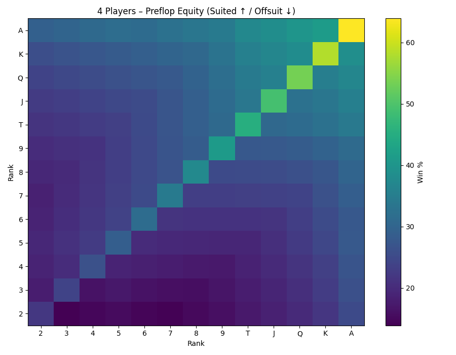
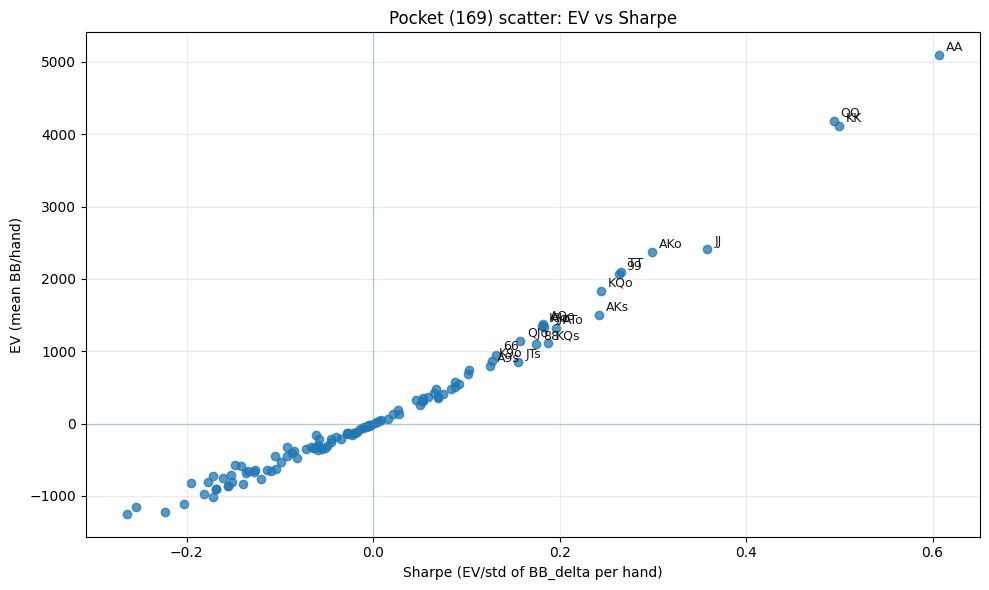
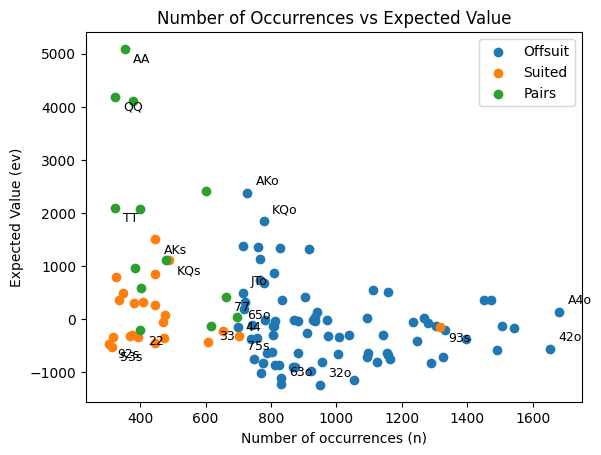

# PokerAI

## Project Overview
This project implements a Texas Hold’em–style poker environment and a set of reinforcement learning agents that learn to play the game through self-play. The poker engine itself is written in C++ for performance and determinism, while the learning agents are implemented in Python using PyTorch. The two are connected via pybind11, allowing Python-based agents to directly control players inside the C++ simulation. Each AI agent has full control over its assigned player and selects actions at every decision point. Agents have access only to public game information (community cards, pot size, betting state, etc.) and their own private hole cards, mirroring the partial observability of real poker. No hidden opponent information is exposed. Importantly, no poker strategy or rules are injected into the model beforehand. The agents are not told which hands are strong, how betting “should” work, or what optimal play looks like. Instead, they learn purely through reinforcement learning by interacting with the environment and maximising long-term reward.

To ensure transparency and reproducibility, the poker rules implemented in this project are described explicitly, as they are a simplified and controlled variant of traditional Texas Hold’em.
- A standard 52-card deck is used and shuffled randomly each hand.
- At the start of each hand, every player is dealt two private cards.
The game proceeds through the usual betting rounds with community cards revealed.

Supported player actions are:
- Fold
- Check
- Call
- Raise
- All-In

To reduce action complexity and stabilise learning, raises are restricted to three discrete sizes:
- Big Blind
- Half Pot
- Full Pot
The dealer button, and with it the blinds, moves one seat after each hand.
This action abstraction keeps the state–action space manageable while still allowing meaningful strategic decisions.

As implemented in `PokerEngine/GameEngine.cpp` (the points the list above leaves open):
- **Seats.** Standard hold'em order. A dealer button moves one seat per hand among the players still in the tournament; on a new engine and after `reset_tournament()` it starts on seat 0. With three or more players the first seat after the button posts the small blind and the next one the big blind. Preflop the seat after the big blind acts first and the big blind acts last: if nobody has raised, it may check or raise. The amount to call preflop is the larger of the two posted blinds, so when the big blind is short (all-in for less than a big blind) it can be the small blind's. On the flop, turn and river the first seat after the button that can still act (has not folded and is not all-in) acts first. Heads-up the button posts the small blind, acts first preflop and last on the later streets.
- **Busted players.** Each hand the button goes to the first seat after the previous button's seat (in seat order, wrapping round) that is still in the tournament, whether or not the previous button has just busted; the blinds then follow from the button as above. There is no dead button and there are no dead blinds. So a player can miss a blind or post the big blind twice in a row: for example, three-handed, if the button busts, the big blind posts the big blind again in the first heads-up hand (tournament rules move the button to prevent this). Until 2a3e3df the engine used a non-standard order (the small blind sat after the big blind and acted last on every street); results measured before then, in the git history, used that order.
- **Raise sizes** are "raise to": the current bet plus one big blind, half the pot or the whole pot (the pot including bets already in front of players). A size below the minimum raise (the last full raise increment) or above the player's stack is illegal. `legalActions` (and `Observation.legal`) lists each size as its own entry with its `raise_to`, marked legal exactly when `step()` accepts it, so the size a player picks is the size played. Until this was fixed, all three sizes were marked legal whenever any raise was, and the training loop silently replaced a rejected size with another size, or check, call, all-in or fold.
- **Betting rounds.** Every player who can still act acts at least once per street, and again after any bet or raise; the street closes when nobody is left to act. When at most one player can act and the bet is matched, the board is run out to showdown.
- **Pots.** Side pots are built from each player's total contribution; ties split the pot, with any odd chip to the winner in the lowest-numbered seat. A hand won by folds pays the whole pot to the last player in.
- **Deck.** Reshuffled every hand. `GameEngine.seed(n)` makes the deals repeatable; otherwise the seed comes from the clock. The shuffle is `std::shuffle`, so the same seed gives the same deals only with the same C++ standard library.

The agents are trained using Deep Q-Learning (DQN) in a self-play setting. Multiple agents compete against one another over hundreds of thousands of hands, continuously updating their policies based on observed rewards. The reward signal is derived from chip (big blind) profit and loss, encouraging agents to learn strategies that maximise expected value over time rather than short-term wins.

To improve interpretability and validate learned behaviour, symbolic regression is applied after training. Using the agent’s simulated data:
Inputs: pocket hand representation (e.g. card ranks, suitedness)
Output: expected value (EV)
This allows explicit mathematical expressions to be discovered that approximate the model’s internal valuation of starting hands. These expressions can then be compared against theoretical expectations and empirical poker knowledge, offering insight into what the agent has learned and why certain hands are favoured.

## Technical Stack

- **C++20** – Core poker engine, game logic, state transitions, and performance-critical simulation
- **Python 3.14** – Reinforcement learning, training loops, evaluation, and analysis
- **pybind11** – Bindings between the C++ poker engine and Python agents
- **PyTorch** – Deep Q-Learning models and optimisation
- **NumPy / Pandas** – Data processing and statistical analysis
- **Matplotlib** – Training curves, EV plots, and hand-strength visualisations


## AI Training Process

### Learning setup

**RL formulation**
- **State (`s`)**: `encode_observation(obs, big_blind)` produces a fixed-length feature vector (151 floats for 4 seats) from the current player’s observation: the player’s private hole cards, the board, pot and amounts to call, street, each seat’s stack and contributions listed relative to the player, and the button’s position relative to the player. Every element and its scaling is specified in [`docs/state_encoding.md`](docs/state_encoding.md). Until the encoding was made relative to the player, the seats were listed by absolute seat number with no indication of which one was the player’s own, so an agent trained in one seat saw a different layout in any other (and the evaluation puts it in every seat).
- **Action (`a`)**: a discrete action index chosen from:
  - Fold, Check, Call, Raise(BB), Raise(Half Pot), Raise(Pot), All-In (exact mapping via `ACTION_NAME` / `A_*` constants).
- **Reward (`r`)**: sparse, terminal-only. When the hand ends (`done=True`), every player who acted in it receives, on its last decision:
  - `reward = (stack_end[player] - stack_start[player]) / big_blind × reward_scale` (`reward_scale` 1.0 by default; 0.01 for the demo agents)
  - i.e. profit/loss in **big blinds** for that hand.
- **Episode termination**: one poker **hand** is treated as an episode. A hand ends when `g.hand_terminal()` becomes true.

**Self-play (multi-agent)**
- Training is **multi-agent self-play**: one `DQNAgent` per model. With as many models as seats (as in `main.ipynb`) each seat has its own agent; with fewer, seat `i` is played by agent `i % len(models)`, so a single model plays every seat and learns from all of them (the demo agents are trained this way).
- Opponents are the other agents in the same hand, or the same agent in the other seats (no external bots).
- The opponent pool is effectively **latest-only** (each agent always plays the current versions of the others). There is no snapshot/league system in this implementation.
- By default the stacks carry over between hands (a tournament, reset when fewer than two players have chips); `reset_stacks=True` resets every stack before each hand, as the demo is played.

**Exploration + legality**
- Action selection uses **epsilon-greedy** inside `agents[acting].select_action(s, mask)`: with probability epsilon a uniformly random legal action. Epsilon falls linearly from `eps_start` (1.0) to `eps_end` (0.05) over the first `eps_decay_hands` (10,000) hands, then stays there (`DQNAgent` arguments). It used to be `max(0, 80 − hands)/201`: at most 40% random actions, and none after the first 80 hands.
- **Legal-action masking**: `mask = legal_mask_from_obs(obs)` marks illegal actions, one entry per action index (each raise size separately), exactly as the engine will judge them. The agent selects using the mask, and the chosen action is the one played: there is no fallback, so an illegal choice would raise an error. A guard (`if mask[a_idx] != 0.0`, choose `random.choice(legal_idxs)`) remains in the loop; with the exact mask it does not fire.

---

### Data generation

**Per-hand logging**
For every completed hand, a row is logged **per player** with:
- identifiers: `run_id`, `hand_id`, `player_id`
- starting hand: `pocket` (e.g. “AKs”, “72o”) derived from `obs_i.hole`
- terminal street information:
  - `street_end`, `street_end_name` (where the player folded or where the hand ended)
- profitability and outcomes:
  - `bb_delta` (stack change in BB units)
  - `profitable` (bb_delta > 0)
  - `folded`
  - `went_showdown` (street_end == river and not folded)
  - `non_showdown_win`
- behavioural stats:
  - `first_action`, `first_action_name`
  - `bb_raised` (BB raised preflop)
  - `raises_made`, `raises_faced`
  - `aggressive` (made at least one raise)

**Logging fixes.** Every player dealt into a hand now gets a row, whether they folded or not, using the hole cards read straight after the deal. `bb_delta` counts the blinds, because stacks are now read before the blinds are posted, so the deltas of a hand sum to zero (the loop asserts this). Busted players are no longer logged. Before these fixes, folded players were never logged (their observation hides their cards by the end of the hand), every hand's deltas summed to +1.5 BB, and busted players reappeared with their last cards and a delta of 0. Mean EV per starting hand was therefore measured only over hands that were not folded. The figures under *Convergence Insight* and *Results* come from the earlier code and have not been regenerated.

**Hands trained (order of magnitude)**
- Training runs for `max_hands` hands (episodes). In the example call, `max_hands=10`, but typical training is intended to scale to **thousands to hundreds of thousands** of hands depending on compute and stability.
- In this codebase, a “hand” means **one full poker hand** across all players, and the dataset logs **one row per player per hand**.

---

### Training loop details

**Replay buffer**
- Each agent stores transitions via `agents[i].remember(s, a, r, s2, done)` (see *Multi-player credit assignment* for when).
- One update per agent per hand with `train_long_memory()`, on a batch sampled uniformly from the agent's replay buffer (a ring of `memory_size` transitions; `batch_size` and `lr` are `DQNAgent` arguments).
- There used to be a single-sample update at every decision as well (`train_short_memory`). It was the bulk of the training cost and is gone.

**Target network**
- `DQNAgent` keeps a target network for the bootstrap targets, copied from the online network every `target_update_freq` (200) hands.

**Optimisation**
- DQN: predicted Q(s,a) against the target reward + gamma × max over the **legal** actions at s’ of the target network's Q(s’,·), where s’ is the player's next decision in the hand. With `double=True` (Double DQN) the online network picks the action at s’ and the target network values it.
- Mean squared error, Adam (`lr`), no gradient clipping (`QTrainer`).

**Update cadence**
- **Per-hand updates**: after the hand ends, every agent runs `train_long_memory()` once.

---

### Reward shaping and multi-player credit assignment

**Reward shaping**
- Rewards are **sparse** (terminal only). During the hand, `reward=0.0`; when `done=True`, reward becomes that player’s **end-of-hand BB profit/loss**.

**Multi-player credit assignment**
- Each seat's decision is stored once its outcome is known: at the seat's next decision in the same hand (reward 0, next state = the state at that decision), or when the hand ends (reward = the seat's BB profit/loss for the hand, `done=True`).
- So every seat that acted in a hand receives its result on its last decision, whoever's action ended the hand. `python bench/check_terminal_rewards.py` checks this on every hand of a short run ([raw](bench/raw/check_terminal_rewards.txt)).
- Before this fix, only the player whose action ended the hand received a non-zero reward. The others' results were stored as `remember(None, 0, r_i, None, True)`, and `train_long_memory` dropped any transition without a state, so, for example, a bettor never learned directly that a bet won when the opponent folded. The agents in the 2,000-hand table of `bench/RESULTS.md` (section 5) were trained that way.

---

### Stability / safety controls (implementation detail)
- Hands are aborted if they exceed `MAX_STEPS_PER_HAND` (2,000 decisions), or if no legal action exists.
- If a hand is aborted, the tournament is reset and the hand is not logged. `history["aborted"]` lists them.
- Before the betting-round fix (see `bench/RESULTS.md`), these guards fired often: a street whose closing seat had folded or was all-in never closed. With some policy mixes 25–50% of hands never finished, so they were aborted and the tournament reset.
- There used to be a 2-second wall-clock limit per hand as well (`HAND_TIMEOUT_SEC`). After the betting fix it was the only guard that fired, on long but legal hands on a busy machine, and because each decision had already updated the network, a seeded run repeated only until its first timeout (`bench/RESULTS.md`, section 4). It is gone, so a seeded run repeats: `bench/rerun_training.py` trains one seed twice, in two processes, and compares the logs row by row.


## Models

All models in this project are intentionally **simple, lightweight implementations** designed to test the learning setup and compare how different network families behave in a poker-style, partially observed environment. Each model outputs **Q-values per action** (Deep Q-Learning), and action selection uses **legal-action masking** so the agent cannot choose invalid moves (e.g., raising when it is not allowed).

### Common I/O (Deep Q)
- **Input (state)**: A compact numeric representation of the current game state (feature vector), such as public cards, pot/bet sizes, street, and the agent’s private hole cards (plus any additional engineered features you include).
- **Output (actions)**: Q-values for the discrete action set (e.g. Fold, Check, Call, Raise[BB/HalfPot/Pot], All-In). Invalid actions are masked before taking `argmax`.

---

### MLPModel (baseline Q-network)
**What it is:** A feed-forward multi-layer perceptron that maps a **single state vector → Q-values**.

**Why it exists (baseline):**
- Fastest and most stable model to train in self-play.
- Good default when the state is already engineered into a fixed-size vector.

**Pros (poker relevance):**
- Works well when “memory” is not required and you encode enough information in the state.
- Efficient for large-scale simulation (millions of decisions).

**Cons:**
- No explicit notion of history; if past betting/action context matters, you must encode it manually as features.

---

### TransformerQModel (attention-based Q-network)
**What it is:** A transformer encoder that processes input as a **sequence** (or as a length-1 sequence if you only pass a vector), then outputs Q-values from the final token.

**Why it exists:**
- Transformers can model relationships between elements (e.g., cards, betting tokens, action-history tokens) using attention.
- Useful if you represent poker state as a sequence: `[hole cards] + [board cards] + [betting/action tokens]`.

**Pros (poker relevance):**
- Can be extended to handle **action history** naturally (important in imperfect-information games).
- Attention can learn “what matters” in complex state representations (e.g., board texture, draw potential).

**Cons:**
- Heavier than MLP; can be more data-hungry and less stable in self-play if not carefully regularised.
- If you feed only a single feature vector (T=1), it behaves more like a richer function approximator than a true sequence model.

**Key hyperparameters (current defaults):**
- `d_model=256`, `nhead=8`, `num_layers=3`, `dim_feedforward=512`, `dropout=0.05`

---

### LSTMModel (recurrent Q-network)
**What it is:** An LSTM that processes a **sequence of state or state-history features**, producing Q-values from the last timestep. With `DQNAgent(..., sequence=True)` the sequence is the player's own encoded states at each of its decisions in the hand so far, the current one last ([`docs/state_encoding.md`](docs/state_encoding.md)); otherwise, as in `main.ipynb`, it is given one state, a sequence of length 1, and has no memory to use.

**Why it exists:**
- Poker is **partially observable**; memory of past actions/bets can matter.
- LSTMs provide a simple way to incorporate temporal context without hand-engineering history features.

**Pros (poker relevance):**
- Can learn patterns over sequences like: betting round progression, aggression trends, or “line” taken this hand.
- Handles variable-length histories naturally (with padding/masking if needed).

**Cons:**
- Harder to train than MLP, and can be slower.
- Still limited compared to attention if long-range dependencies are important.

**Key hyperparameters (current defaults):**
- `hidden_dim=1024`, `layer_dim=3`, `dropout=0.05`

---

### GRUModel (recurrent Q-network, lighter than LSTM)
**What it is:** A GRU-based sequence model similar to the LSTM approach, generally with fewer gates and slightly cheaper compute. It is given the same sequences as the LSTM (the hand so far with `sequence=True`, one state otherwise). The demo's `gru` candidate is one GRU layer of 128 over the hand so far.

**Why it exists:**
- Same motivation as LSTM (history matters), but with a simpler recurrent cell.

**Pros (poker relevance):**
- Often trains faster than LSTM and can be more stable.
- Good “middle ground” between MLP simplicity and sequence modelling.

**Cons:**
- Still recurrent (sequential compute), so slower than MLP.
- Like LSTM, performance depends heavily on how you format and feed the sequence.

**Key hyperparameters (current defaults):**
- `hidden_dim=1024`, `layer_dim=3`, `dropout=0.05`

---

### Why not bigger models?
Bigger networks are not automatically better here because:
- **Self-play overfitting risk:** larger models can overfit to quirks of the current opponent pool.
- **Diminishing returns:** poker performance often improves more from better state representation, evaluation, and opponent diversity than from scaling parameters.
- **Compute constraints:** simulation + training is already expensive; smaller models allow more hands, more experiments, and faster iteration.


## Convergence Insight

The primary metric tracked during training is **big blind delta (BB/hand)**, which directly measures profitability and aligns with standard poker evaluation. Convergence is assessed by analysing both **aggregate pocket-level statistics** and **time-evolving cumulative averages**.

### Comparison to theoretical preflop equity

As a reference point, the theoretical preflop win rates for a **4-player game** are shown below:

<p align="center">
  
</p>

These values represent idealised equity assuming perfect play and no postflop skill differences.

The following plots show the **simulated expected value by pocket hand** after self-play training:

<p align="center">
  
</p>

<p align="center">
  
</p>

At **50,000 hands**, the learned ordering incorrectly ranks **QQ above AA**, indicating insufficient exploration and unstable estimates. By **100,000 hands**, **pocket aces (AA)** emerge as the highest-EV hand, matching theoretical expectations. This shift suggests that the agents are gradually correcting early misestimations as more data is observed.

While this alignment with theory is encouraging, it is **not sufficient on its own** to claim convergence.

---

### Cumulative average EV curves (stronger indicator)

A more reliable signal comes from tracking the **cumulative average BB/hand over time** for individual pocket hands:

<p align="center">
  
</p>

These curves show:
- High-variance behaviour early in training
- Gradual flattening as the number of hands increases
- Reduced drift in later stages, indicating stabilising policies

Moving averages are applied to reduce noise from short-term variance, making long-run trends clearer.

Convergence is identified heuristically when:
- The slope of cumulative EV curves approaches zero over a large window
- Relative ordering between strong hands (AA, KK, QQ) stabilises
- Weak hands (e.g. 72o) consistently converge to negative EV

---

### What convergence does *not* mean

Observed convergence does **not** imply:
- A Nash equilibrium
- Exploitability minimisation
- Robustness against unseen opponent strategies

The policies are only guaranteed to be stable **within the self-play population** used during training. Changes to opponent behaviour, bet sizing, or reward structure may invalidate these equilibria.

These limitations are discussed further in the *Limitations & Future Work* section.


## Symbolic Regression

### Purpose

Symbolic regression is used to **interpret** the behaviour learned by the reinforcement learning agents by compressing empirical outcomes into **human-readable mathematical expressions**.

The goals are:
- **Interpretability**: identify which hand features most strongly influence expected value (EV).
- **Sanity checking**: compare learned relationships against known poker theory (e.g. pair dominance, rank ordering).
- **Model comparison**: analyse how different architectures encode hand strength.

---

### Features and targets

The following features are provided to the symbolic regression model:

- `rank_high`: higher of the two hole card ranks  
- `rank_low`: lower of the two hole card ranks  
- `is_pair`: binary indicator for pocket pairs  
- `is_suited`: binary indicator for suited hands  

The regression targets include:
- **Expected value (EV / BB delta)**
- **Win probability**
- **Non-showdown win rate**
- **Profitability probability**

---

### Discovered equations

Below are representative symbolic expressions discovered for EV estimation.

**Theoretical preflop data**
```

square(((rank_low * 0.0174) / (0.6269 ^ is_pair)) + 0.3986)

```

**Simulated data (all models combined)**
```

(cube(is_pair + sqrt(rank_low)) - 14.4768) * 0.01224

```

**Per-model learned structures**
- **MLP**
```

square((is_pair + (rank_low * 0.2322)) * 0.2567) - 0.1335

```

- **LSTM**
```

((rank_high / 13.2923) * (is_pair + 0.6166)) - 0.4758

```

- **GRU**
```

(cube(is_pair + log(rank_low)) * 0.02798) - 0.1522

```

- **Transformer**
```

(rank_low * ((is_pair * 0.0560) + 0.0454)) - 0.2473

```

---

### Interpretation

The **absolute constants and outer nonlinearities** (e.g. square, cube) are less important than the **relative influence of variables**, which can be analysed via partial derivatives.

Key observations:
- In the **theoretical equation**, EV is primarily driven by the *lower-ranked card*, with a **multiplicative boost for pocket pairs**.
- In the **simulated and learned equations**, EV consistently depends on:
  - card rank (rank_low and/or rank_high)
  - a strong non-linear boost when `is_pair = 1`
- Across models, **pair status dominates** hand valuation, while non-pair hands rely more heavily on raw rank magnitude.

Architectural differences emerge:
- **MLP / GRU** emphasise `rank_low` combined with `is_pair`
- **LSTM** incorporates both `rank_high` and `is_pair`, suggesting some sensitivity to relative rank ordering
- **Transformer** learns a nearly linear interaction between rank and pair status, consistent with its bias toward additive structure

Overall, the learned symbolic structures closely mirror known poker theory: **pairs dominate, higher ranks matter more, and non-pair hands scale gradually with card strength**.

---

### Takeaway

Symbolic regression confirms that, despite being trained purely through self-play without injected rules, the agents learn **interpretable, theory-aligned representations of hand strength**, while still exhibiting architecture-specific biases in how that strength is encoded.


## Validation & Metrics

Given the self-play nature of this project, validation focuses on **internal consistency, stability over time, and alignment with known poker theory**, rather than external optimality guarantees.

---

### Reported metrics

All metrics are computed from the per-hand CSV logs generated during training.

- **Mean EV (`bb_delta`)**  
  Average profit/loss per hand in big blinds.
- **EV standard deviation**  
  Used to quantify variance and risk.
- **Sharpe-style ratio**  
  Mean EV divided by standard deviation, used as a stability proxy.
- **Profitability rate**  
  Fraction of hands with `bb_delta > 0`.
- **Showdown vs non-showdown win rates**
- **Fold rate and aggression indicators**  
  (raises made, raises faced, BB raised preflop)

Metrics are analysed both **globally** and **per pocket hand**.

---

### Validation approach

**Convergence analysis**
- Cumulative average EV (BB/hand) is tracked over time.
- Stabilisation and flattening of these curves are used as a primary convergence signal.

**Pocket-level consistency**
- Learned EV rankings across the 169 starting hands are compared against:
  - Theoretical preflop equity ordering
  - Expected dominance of pairs over non-pairs
  - Suited vs offsuit differentials

**Sample size awareness**
- EV is analysed alongside occurrence counts.
- Hands with low frequency are treated as higher-variance estimates rather than strong conclusions.

**Model comparison**
- Different architectures (MLP, LSTM, GRU, Transformer) are evaluated using the same metrics.
- Agreement in high-level trends across models increases confidence that results are not architecture-specific artefacts.

---

### What this validation does and does not show

This validation demonstrates that:
- Agents learn **stable, poker-consistent hand valuations**
- Learned strategies converge to internally coherent policies
- Results are reproducible across architectures and training runs. *(Not supported by the repository: the runs behind the figures were not recorded, and the deck was seeded from the clock. Runs can now be repeated with a seed; see `bench/winrate.py`.)*

However, it does **not** guarantee:
- Nash equilibrium strategies
- Minimal exploitability
- Robustness against unseen opponent populations

Win rate against fixed baseline bots (random, calling, tight), in big blinds per 100 hands with 95% intervals, is measured in [`bench/RESULTS.md`](bench/RESULTS.md): for the demo agents at 100 big blinds (section 6, which supersedes the 2,000-hand table of section 5). Cross-play leagues and exploitability-style testing are still future work.


## Limitations & Future Work

### Limitations

This project intentionally uses a **simplified poker environment**, which introduces several known limitations.

**Action abstraction**
- Raise sizes are restricted to a small discrete set (BB, half-pot, pot, all-in).
- This reduces realism and limits the agents’ ability to express nuanced bet sizing strategies.

**Self-play overfitting**
- Agents are trained exclusively against a fixed set of opponents.
- Over time, policies may overfit to the specific tendencies of these agents rather than learning broadly robust strategies.
- This can lead to meta-cycling and population-specific equilibria.

**Partial observability and limited memory**
- The environment is partially observable by design.
- When using feed-forward models, agents are effectively memoryless and rely entirely on the current encoded state.
- This limits the ability to condition decisions on betting history or inferred opponent behaviour.

**Multi-player RL instability**
- Training occurs in a multi-agent, non-stationary environment.
- Each agent’s learning alters the effective environment for all others, which can slow convergence and introduce instability.

**Initial-condition bias**
- The ratio between starting stack size and blind size is relatively fixed.
- This may bias strategies toward deep-stack play and reduce exposure to edge cases such as short-stack or all-in-dominated scenarios.
- The demo agents are trained and measured at one depth only, 100 big blinds with stacks reset every hand; how they play at other depths is not measured.

**Sample size limitations**
- Some pocket hands occur infrequently, leading to noisy EV estimates despite large overall hand counts.

**Performance constraints**
- Training relies on frequent data transfer between C++ (simulation) and Python (learning) via pybind11.
- This introduces significant overhead; for example, ~30,000 hands required several hundred CPU hours.
- The current setup prioritises correctness and flexibility over raw throughput.
- *Measured since* (`bench/RESULTS.md`, Apple M1 Pro, CPU): the engine runs about 44,000 hands/s in C++ and 13,500 hands/s through the binding with fixed policies. The training loop's engine, binding and encoding work costs about 0.54 ms per hand. With the old loop (a single-sample update at every decision as well as the replay update), training the four README models cost about 0.36 s and 0.8–1.2 CPU-seconds per hand, so 30,000 hands would have come to roughly 7–10 CPU-hours, an extrapolation from 2,000-hand runs. The networks' updates, not the C++↔Python crossing, dominate. The "several hundred CPU hours" figure was not reproduced; hands that hung on the old engine until the training loop's 2-second timeout may account for part of it.
- With the loop as it now is (one replay update per hand), one network playing all four seats at 100 big blinds trained at about 190 hands per CPU-second for the 37,000-parameter MLP, 85 for the 474,000-parameter MLP and 17 for the GRU (`bench/RESULTS.md`, section 6: 400,000 hands in 0.58–0.60, 1.31–1.33 and, for 150,000 hands, 2.15–2.56 CPU-hours).

---

### Future Work

Several extensions could meaningfully improve realism, stability, and performance:

- **Richer temporal modelling**
  - The GRU/LSTM models can now be given the hand so far (`sequence=True`); explicit action-history tokens for transformer-based agents are still future work.
- **Improved self-play diversity**
  - Population-based training or opponent snapshotting to reduce overfitting.
- **Stronger evaluation**
  - Cross-play leagues, fixed baseline bots, and exploitability-style testing.
- **More realistic game dynamics**
  - Finer-grained bet sizing, variable stack depths, and rake modelling.
- **Richer state representations**
  - Pot odds, implied odds, and betting-history features (position relative to the button is now encoded).
- **Alternative learning algorithms**
  - Actor–critic methods (e.g. PPO) or NFSP-style approaches for imperfect-information games.
- **Performance optimisation**
  - Move the agent logic and training loop fully into C++ using libtorch to eliminate Python↔C++ transfer overhead and enable much larger-scale training.


## How to run

### 1) Create a virtual environment + install Python deps
```bash
python -m venv venv
source venv/bin/activate   # macOS/Linux
# venv\Scripts\activate    # Windows (PowerShell)

python -m pip install --upgrade pip
python -m pip install -r requirements.txt
```

### 2) Build / sanity-check the C++ engine

```bash
cd PokerEngine
g++ -std=c++20 poker.cpp Player.cpp GameEngine.cpp -O2 -o poker_engine && ./poker_engine
```

### 3) Build the pybind11 module (C++ ↔ Python bindings)

```bash
python setup.py build_ext --inplace
```

### 4) Tests and measurements

Engine tests (C++, no extra dependencies), from the repository root:

```bash
cmake -S . -B build -DCMAKE_BUILD_TYPE=Release && cmake --build build && ctest --test-dir build --output-on-failure
```

- `test_hand_eval`: known answers for every hand category and the main tie-breaks.
- `test_betting`: betting rounds through the `step()` API: every seat acts, every street closes, chips are conserved; the seat order (button, blinds, who acts first and last on each street, the big blind's option) for 2, 3, 4 and 6 seats, and the button's moves as players bust; every action `legalActions` marks legal is accepted and every other one rejected, raise sizes included.
- `eval_exhaustive`: every 5-card and 7-card hand (133,784,560) against an independent reference evaluator and the published category counts (about a minute on 10 threads).

Python tests (training code, and the exported agents in `weights/demo/`), with the extension built:

```bash
python -m unittest discover -s tests -v
```

`sh bench/run_benchmarks.sh` re-runs the tests and the throughput benchmarks with the venv active. `sh bench/run_benchmarks.sh winrate` also trains and evaluates the README's four agents for 2,000 hands (about an hour; superseded, see `bench/RESULTS.md` section 5). Results, method and raw output: [`bench/RESULTS.md`](bench/RESULTS.md).

### 5) Demo agents (trained weights)

The agents for the browser demo (4 seats, 100 big blinds, stacks reset every hand) are trained, evaluated, selected and exported with one command, with the venv active:

```bash
JOBS=6 sh bench/run_benchmarks.sh demo
```

It runs `bench/train_demo.py --all` (every candidate and seed in [`bench/SELECTION.md`](bench/SELECTION.md) whose `weights/runs/<run>/run.json` is not there yet, `JOBS` at a time), `bench/eval_demo.py` (evaluation and the selection rule), `bench/confirm_demo.py` (the selected agents again, on fresh deals), `bench/export_weights.py` and the Python tests. The weights, their format and how to play one decision with them: [`weights/README.md`](weights/README.md). The state vector: [`docs/state_encoding.md`](docs/state_encoding.md). Results: [`bench/RESULTS.md`](bench/RESULTS.md), section 6.

### 6) Run training / experiments (Jupyter)


Open `main.ipynb` and edit the model list / hyperparameters:

```python
model_0 = MLPModel(input_features=input_features, output_features=output_features,
                   hidden=(512, 1024, 2048, 1024, 512))
model_1 = LSTMModel(input_dim=input_features, output_dim=output_features)
model_2 = GRUModel(input_dim=input_features, output_dim=output_features)
model_3 = TransformerQModel(input_size=input_features, num_actions=output_features)

models = [model_0, model_1, model_2, model_3]
```

Game + training parameters:

```python
MA_WINDOW = 50
STARTING_AMOUNT = 10000
BIG_BLIND = 2
SMALL_BLIND = 1
MAX_HANDS = 10

agents, history = train_poker_dqn(
    models=models,
    n_players=len(models),
    starting_stack=STARTING_AMOUNT,
    big_blind=BIG_BLIND,
    small_blind=SMALL_BLIND,
    max_hands=MAX_HANDS,
    device="cpu",
    ma_window=MA_WINDOW,
)
```

## Results

### Demo agents at 100 big blinds (measured)

One network, `mlp-s` seed 3 (151 → 128 → 128 → 7, 36,871 parameters), plays all three agent seats of the browser demo. It was selected from nine candidates (two MLP sizes and a GRU, three seeds each) by the rule in [`bench/SELECTION.md`](bench/SELECTION.md), written before training. On 40,000 duplicate deals per baseline (4 seats, stacks reset to 100 big blinds every hand) it wins +359 [332, 386] bb/100 against random bots, +341 [323, 359] against calling bots and +16 [11, 21] against tight bots, and +372, +332 and +18 on fresh deals. Of the other eight candidates, none beats the tight bot with an interval above zero. Full table, method and what is not measured: [`bench/RESULTS.md`](bench/RESULTS.md), section 6; the weights: [`weights/`](weights/README.md).

The rest of this section summarises the learned behaviour of the agents after self-play training, focusing on expected value (EV), stability, and variance across starting hands. These figures come from the old code and logging and have not been regenerated.

---

### Pocket hand expected value (100,000 hands)

<p align="center">
  
</p>

This heatmap shows the **mean EV (BB/hand)** for each of the 169 starting hand combinations after 100,000 simulated hands.  
Stronger hands (AA, KK, QQ, AK) consistently emerge as high-EV, while weak offsuit hands converge to negative EV, broadly matching theoretical expectations.

---

### Convergence behaviour (cumulative average EV)

<p align="center">
  
</p>

The cumulative average EV per hand is plotted over time for selected pocket hands.  
Early training exhibits high variance, while later stages show **flattening curves**, indicating stabilisation of learned strategies. Strong hands converge to positive EV, while weak hands stabilise below zero.

---

### EV vs risk (Sharpe-style analysis)

<p align="center">
  
</p>

This scatter plot compares **mean EV** against a Sharpe-style risk metric (mean / standard deviation).  
Some hands exhibit high EV but also high variance, while others achieve more stable returns. This highlights that maximising EV alone does not necessarily minimise risk.

---

### Expected value vs occurrence frequency

<p align="center">
  
</p>

This plot shows EV as a function of how often each pocket hand appears.  
Hands with low occurrence counts tend to have noisier EV estimates, reinforcing the need for large sample sizes when evaluating individual pocket performance.

---

### Key observations

- **Premium hands are sometimes overplayed early**, leading to unnecessary variance in multiway pots.
- **EV estimates stabilise over time**, with correct ordering of top hands emerging only after sufficient training.
- **Rare hands exhibit higher variance**, even late in training, due to limited samples.
- The learned ordering of hands broadly aligns with theoretical preflop strength, despite no hard-coded poker knowledge.
