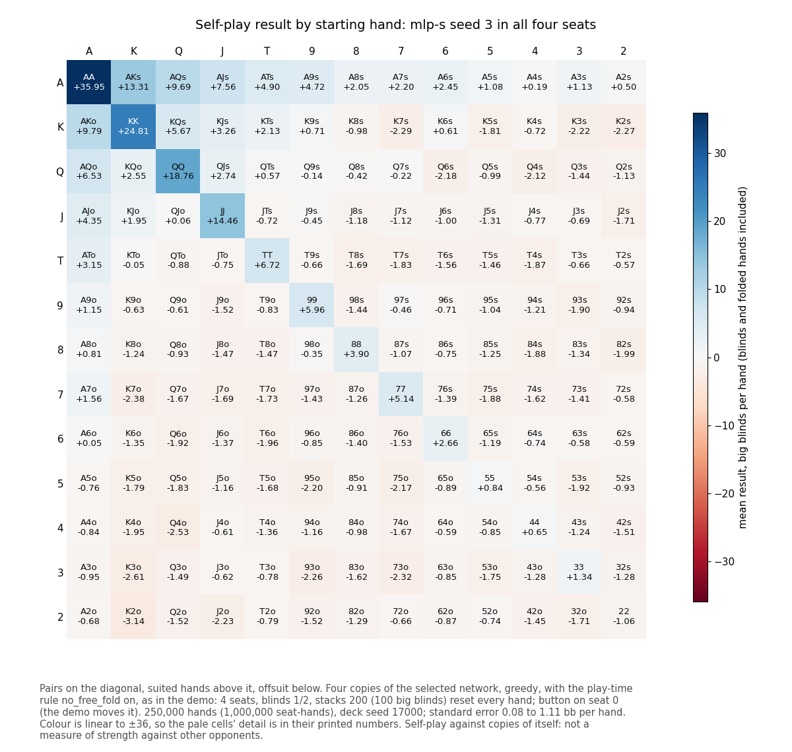
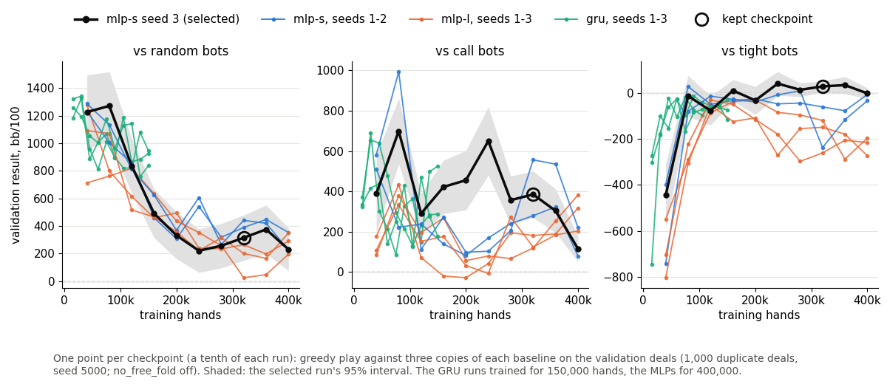
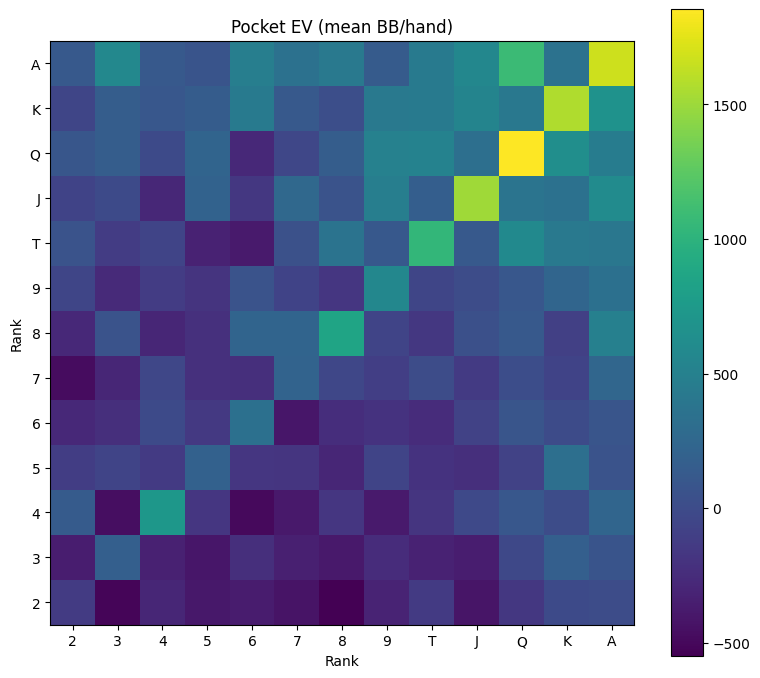
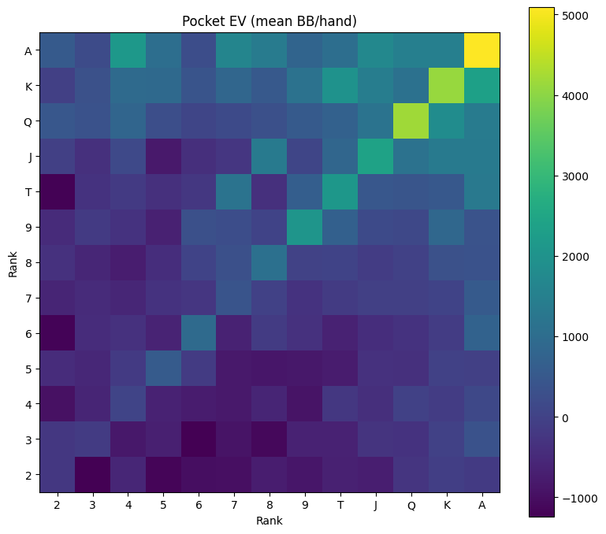
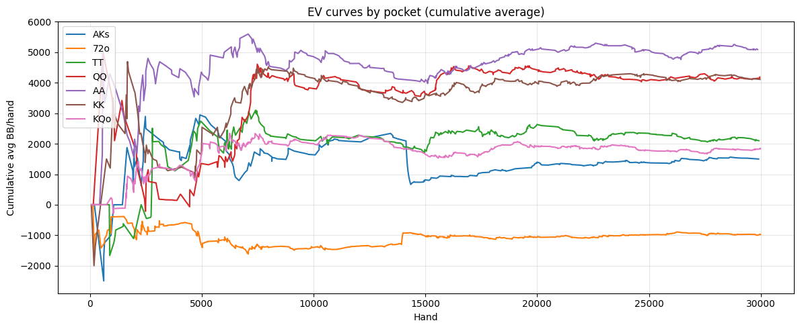

# PokerAI

## Project Overview
This project implements a Texas Hold’em–style poker environment and a set of reinforcement learning agents that learn to play the game through self-play. The poker engine itself is written in C++ for performance and determinism, while the learning agents are implemented in Python using PyTorch. The two are connected via pybind11, allowing Python-based agents to directly control players inside the C++ simulation. Each AI agent has full control over its assigned player and selects actions at every decision point. Agents have access only to public game information (community cards, pot size, betting state, etc.) and their own private hole cards, mirroring the partial observability of real poker. No hidden opponent information is exposed. Importantly, no poker strategy or rules are injected into the model beforehand. The agents are not told which hands are strong, how betting “should” work, or what optimal play looks like. Instead, they learn purely through reinforcement learning by interacting with the environment and maximising long-term reward.

To ensure transparency and reproducibility, the poker rules implemented in this project are described explicitly, as they are a simplified and controlled variant of traditional Texas Hold’em.
- A standard 52-card deck is used and shuffled randomly each hand.
- At the start of each hand, every player is dealt two private cards.
The game proceeds through the usual betting rounds with community cards revealed.

Supported player actions are:
- Fold
- Check
- Call
- Raise
- All-In

To reduce action complexity and stabilise learning, raises are restricted to three discrete sizes:
- Big Blind
- Half Pot
- Full Pot
The dealer button, and with it the blinds, moves one seat after each hand.
This action abstraction keeps the state–action space manageable while still allowing meaningful strategic decisions.

As implemented in `PokerEngine/GameEngine.cpp` (the points the list above leaves open):
- **Seats.** Standard hold'em order. A dealer button moves one seat per hand among the players still in the tournament; on a new engine and after `reset_tournament()` it starts on seat 0. With three or more players the first seat after the button posts the small blind and the next one the big blind. Preflop the seat after the big blind acts first and the big blind acts last: if nobody has raised, it may check or raise. The amount to call preflop is the larger of the two posted blinds, so when the big blind is short (all-in for less than a big blind) it can be the small blind's. On the flop, turn and river the first seat after the button that can still act (has not folded and is not all-in) acts first. Heads-up the button posts the small blind, acts first preflop and last on the later streets.
- **Busted players.** Each hand the button goes to the first seat after the previous button's seat (in seat order, wrapping round) that is still in the tournament, whether or not the previous button has just busted; the blinds then follow from the button as above. There is no dead button and there are no dead blinds. So a player can miss a blind or post the big blind twice in a row: for example, three-handed, if the button busts, the big blind posts the big blind again in the first heads-up hand (tournament rules move the button to prevent this). Until 2a3e3df the engine used a non-standard order (the small blind sat after the big blind and acted last on every street); results measured before then, in the git history, used that order.
- **Raise sizes** are "raise to": the current bet plus one big blind, half the pot or the whole pot (the pot including bets already in front of players). A size below the minimum raise (the last full raise increment) or above the player's stack is illegal. `legalActions` (and `Observation.legal`) lists each size as its own entry with its `raise_to`, marked legal exactly when `step()` accepts it from the player to act, so the size a player picks is the size played. (`step(action, seat)` always acts for the current player, whatever `seat` is, and `getObservation(seat)` for a seat that is not to act still lists that seat's actions as if it were.) Until this was fixed, all three sizes were marked legal whenever any raise was, and the training loop silently replaced a rejected size with another size, or check, call, all-in or fold.
- **Betting rounds.** Every player who can still act acts at least once per street, and again after any bet or raise; the street closes when nobody is left to act. When at most one player can act and the bet is matched, the board is run out to showdown.
- **Pots.** Side pots are built from each player's total contribution; ties split the pot, with any odd chip to the winner in the lowest-numbered seat. A hand won by folds pays the whole pot to the last player in.
- **Deck.** Reshuffled every hand. `GameEngine.seed(n)` makes the deals repeatable; otherwise the seed comes from the clock. The shuffle is `std::shuffle`, so the same seed gives the same deals only with the same C++ standard library.

### Where the rules differ from tournament poker, and the formats results are measured in

Deviations from tournament rules, each read from `PokerEngine/GameEngine.cpp` (the bullets above give the detail):
- **Button after busts:** it goes to the next live seat after the previous button's seat, with no dead button or dead blinds, so a player can post the big blind twice in a row.
- **Odd chip:** a split pot's odd chip goes to the lowest-numbered winning seat (per side pot), not the first winner left of the button.
- **Short all-in raise:** an all-in that raises by less than the minimum raise does not change the minimum raise, but it still reopens the betting for players who have already acted (tournament rules would not).
- **Raise sizes:** three "raise to" sizes only (the bet plus one big blind, half the pot, the pot; the pot is measured before the raiser's own call, so a "pot" raise is smaller than a conventional pot-sized raise). No other amount, no ante, blinds fixed, no limit on the number of raises.

Game formats used by the training and evaluation scripts, checked against the code (`train_poker_dqn(reset_stacks=...)`, `winrate.play_hand`, `winrate.evaluate`); blinds are 1/2 everywhere and 4 seats everywhere:

| script | stack (chips / big blinds) | stacks between hands | button | players |
|---|---|---|---|---|
| `main.ipynb` (training) | 10,000 / 5,000 | carried over; the tournament resets when fewer than two players have chips | moves one seat per hand among players with chips; seat 0 after a reset | four different networks, one per seat, no bots |
| `bench/train_demo.py` (demo agents) | 200 / 100 | reset every hand (`reset_stacks=True`, which calls `reset_tournament`) | seat 0 every hand | one network in all four seats |
| `bench/winrate.py` (its own training run, RESULTS section 5) | trains at 10,000 / 5,000 with carry-over as the notebook; evaluates at 10,000 | evaluation: reset every hand | evaluation: seat 0 every hand | agent against three copies of one bot |
| `bench/eval_demo.py`, `confirm_demo.py`, `eval_suite.py` | 200 / 100 (`eval_suite.py` varies it) | reset every hand | seat 0 every hand; duplicate deals put the agent in each of the four seats, so it plays every position equally often | agent against three copies of one bot, greedy |

With stacks reset every hand and the button fixed on seat 0, the only difference from a moving button is which seat gets an odd chip; duplicate deals rotate the agent through all four positions. What carries over from the 100-big-blind format to other stack depths and to carried-over stacks is measured, for the demo agents, in `bench/RESULTS.md` section 12. Every result there states its format.

The agents are trained using Deep Q-Learning (DQN) in a self-play setting. Multiple agents compete against one another over hundreds of thousands of hands, continuously updating their policies based on observed rewards. The reward signal is derived from chip (big blind) profit and loss, encouraging agents to learn strategies that maximise expected value over time rather than short-term wins.

To improve interpretability and validate learned behaviour, symbolic regression is applied after training. Using the agent’s simulated data:
Inputs: pocket hand representation (e.g. card ranks, suitedness)
Output: expected value (EV)
This allows explicit mathematical expressions to be discovered that approximate the model’s internal valuation of starting hands. These expressions can then be compared against theoretical expectations and empirical poker knowledge, offering insight into what the agent has learned and why certain hands are favoured.

## Technical Stack

- **C++20** – Core poker engine, game logic, state transitions, and performance-critical simulation
- **Python 3.14** – Reinforcement learning, training loops, evaluation, and analysis
- **pybind11** – Bindings between the C++ poker engine and Python agents
- **PyTorch** – Deep Q-Learning models and optimisation
- **NumPy / Pandas** – Data processing and statistical analysis
- **Matplotlib** – Training curves, EV plots, and hand-strength visualisations


## AI Training Process

### Learning setup

**RL formulation**
- **State (`s`)**: `encode_observation(obs, big_blind)` produces a fixed-length feature vector (151 floats for 4 seats) from the current player’s observation: the player’s private hole cards, the board, pot and amounts to call, street, each seat’s stack and contributions listed relative to the player, and the button’s position relative to the player. Every element and its scaling is specified in [`docs/state_encoding.md`](docs/state_encoding.md). Until the encoding was made relative to the player, the seats were listed by absolute seat number with no indication of which one was the player’s own, so an agent trained in one seat saw a different layout in any other (and the evaluation puts it in every seat).
- **Action (`a`)**: a discrete action index chosen from:
  - Fold, Check, Call, Raise(BB), Raise(Half Pot), Raise(Pot), All-In (exact mapping via `ACTION_NAME` / `A_*` constants).
- **Reward (`r`)**: sparse, terminal-only. When the hand ends (`done=True`), every player who acted in it receives, on its last decision:
  - `reward = (stack_end[player] - stack_start[player]) / big_blind × reward_scale` (`reward_scale` 1.0 by default; 0.01 for the demo agents)
  - i.e. profit/loss in **big blinds** for that hand.
- **Episode termination**: one poker **hand** is treated as an episode. A hand ends when `g.hand_terminal()` becomes true.

**Self-play (multi-agent)**
- Training is **multi-agent self-play**: one `DQNAgent` per model. With as many models as seats (as in `main.ipynb`) each seat has its own agent; with fewer, seat `i` is played by agent `i % len(models)`, so a single model plays every seat and learns from all of them (the demo agents are trained this way).
- Opponents are the other agents in the same hand, or the same agent in the other seats (no external bots).
- The opponent pool is effectively **latest-only** (each agent always plays the current versions of the others). There is no snapshot/league system in this implementation.
- By default the stacks carry over between hands (a tournament, reset when fewer than two players have chips); `reset_stacks=True` resets every stack before each hand, as the demo is played.

**Exploration + legality**
- Action selection uses **epsilon-greedy** inside `agents[acting].select_action(s, mask)`: with probability epsilon a uniformly random legal action. Epsilon falls linearly from `eps_start` (1.0) to `eps_end` (0.05) over the first `eps_decay_hands` (10,000) hands, then stays there (`DQNAgent` arguments). It used to be `max(0, 80 − hands)/201`: at most 40% random actions, and none after the first 80 hands.
- **Legal-action masking**: `mask = legal_mask_from_obs(obs)` marks illegal actions, one entry per action index (each raise size separately), exactly as the engine will judge them for the player to act. The agent selects using the mask, and the chosen action is the one played: there is no fallback, so an illegal choice would raise an error. A guard (`if mask[a_idx] != 0.0`, choose `random.choice(legal_idxs)`) remains in the loop; with the exact mask it does not fire.

---

### Data generation

**Per-hand logging**
For every completed hand, a row is logged **per player** with:
- identifiers: `run_id`, `hand_id`, `player_id`
- starting hand: `pocket` (e.g. “AKs”, “72o”) derived from `obs_i.hole`
- terminal street information:
  - `street_end`, `street_end_name` (where the player folded or where the hand ended)
- profitability and outcomes:
  - `bb_delta` (stack change in BB units)
  - `profitable` (bb_delta > 0)
  - `folded`
  - `went_showdown` (street_end == river and not folded)
  - `non_showdown_win`
- behavioural stats:
  - `first_action`, `first_action_name`
  - `bb_raised` (BB raised preflop)
  - `raises_made`, `raises_faced`
  - `aggressive` (made at least one raise)

**Logging fixes.** Every player dealt into a hand now gets a row, whether they folded or not, using the hole cards read straight after the deal. `bb_delta` counts the blinds, because stacks are now read before the blinds are posted, so the deltas of a hand sum to zero (the loop asserts this). Busted players are no longer logged. Before these fixes, folded players were never logged (their observation hides their cards by the end of the hand), every hand's deltas summed to +1.5 BB, and busted players reappeared with their last cards and a delta of 0. Mean EV per starting hand was therefore measured only over hands that were not folded. Figs. 1 and 2 under *Results by starting hand and over training* are regenerated from the current code; the first version's figures, which came from the earlier code and cannot be regenerated, are kept as history at the end of *Results*.

**Hands trained (order of magnitude)**
- Training runs for `max_hands` hands (episodes). In the example call, `max_hands=10`, but typical training is intended to scale to **thousands to hundreds of thousands** of hands depending on compute and stability.
- In this codebase, a “hand” means **one full poker hand** across all players, and the dataset logs **one row per player per hand**.

---

### Training loop details

**Replay buffer**
- Each agent stores transitions via `agents[i].remember(s, a, r, s2, done)` (see *Multi-player credit assignment* for when).
- One update per agent per hand with `train_long_memory()`, on a batch sampled uniformly from the agent's replay buffer (a ring of `memory_size` transitions; `batch_size` and `lr` are `DQNAgent` arguments).
- There used to be a single-sample update at every decision as well (`train_short_memory`). It was the bulk of the training cost and is gone.

**Target network**
- `DQNAgent` keeps a target network for the bootstrap targets, copied from the online network after every `target_update_freq` (200) completed hands: after hands 200, 400, and so on (the counter is incremented before the update step).

**Optimisation**
- DQN: predicted Q(s,a) against the target reward + gamma × max over the **legal** actions at s’ of the target network's Q(s’,·), where s’ is the player's next decision in the hand. With `double=True` (Double DQN) the online network picks the action at s’ and the target network values it.
- The loss is taken on the chosen action only, Q(s,a) against the target: mean squared error by default, `loss="huber"` for smooth L1. Adam (`lr`); gradient-norm clipping is off unless `max_grad_norm` is set (`QTrainer`, `DQNAgent` arguments).
- Greedy action selection runs the online network in eval mode (no dropout) and restores the previous mode; the update step runs it in train mode.

**Update cadence**
- **Per-hand updates**: after the hand ends, every agent runs `train_long_memory()` once.

---

### Reward shaping and multi-player credit assignment

**Reward shaping**
- Rewards are **sparse** (terminal only). During the hand, `reward=0.0`; when `done=True`, reward becomes that player’s **end-of-hand BB profit/loss**.

**Multi-player credit assignment**
- A hand's transitions are kept until the hand finishes and are added to replay then; an aborted hand adds none, so replay never holds an incomplete episode.
- Each seat's decision is stored once its outcome is known: at the seat's next decision in the same hand (reward 0, next state = the state at that decision), or when the hand ends (reward = the seat's BB profit/loss for the hand, `done=True`).
- So every seat that acted in a hand receives its result on its last decision, whoever's action ended the hand. `python bench/check_terminal_rewards.py` checks this on every hand of a short run ([raw](bench/raw/check_terminal_rewards.txt)).
- Before this fix, only the player whose action ended the hand received a non-zero reward. The others' results were stored as `remember(None, 0, r_i, None, True)`, and `train_long_memory` dropped any transition without a state, so, for example, a bettor never learned directly that a bet won when the opponent folded. The agents in the 2,000-hand table of `bench/RESULTS.md` (section 5) were trained that way.

---

### Stability / safety controls (implementation detail)
- Each update step sets `agent.last_stats` (`td_abs_mean`, `td_abs_max`, `q_abs_max`, `grad_norm` before clipping, `nonfinite` count of NaN/Inf in the loss and gradients). `bench/train_demo.py` averages them between checkpoints into `log.jsonl`.
- Hands are aborted if they exceed `MAX_STEPS_PER_HAND` (2,000 decisions), or if no legal action exists.
- If a hand is aborted, the tournament is reset and the hand is not logged. `history["aborted"]` lists them.
- Before the betting-round fix (see `bench/RESULTS.md`), these guards fired often: a street whose closing seat had folded or was all-in never closed. With some policy mixes 25–50% of hands never finished, so they were aborted and the tournament reset.
- There used to be a 2-second wall-clock limit per hand as well (`HAND_TIMEOUT_SEC`). After the betting fix it was the only guard that fired, on long but legal hands on a busy machine, and because each decision had already updated the network, a seeded run repeated only until its first timeout (`bench/RESULTS.md`, section 4). It is gone, so a seeded run repeats on the same machine, software and number of threads: `bench/rerun_training.py` trains one seed twice, in two processes, and compares the logs row by row.


## Models

All models in this project are intentionally **simple, lightweight implementations** designed to test the learning setup and compare how different network families behave in a poker-style, partially observed environment. Each model outputs **Q-values per action** (Deep Q-Learning), and action selection uses **legal-action masking** so the agent cannot choose invalid moves (e.g., raising when it is not allowed).

### Common I/O (Deep Q)
- **Input (state)**: A compact numeric representation of the current game state (feature vector), such as public cards, pot/bet sizes, street, and the agent’s private hole cards (plus any additional engineered features you include).
- **Output (actions)**: Q-values for the discrete action set (e.g. Fold, Check, Call, Raise[BB/HalfPot/Pot], All-In). Invalid actions are masked before taking `argmax`.

---

### MLPModel (baseline Q-network)
**What it is:** A feed-forward multi-layer perceptron that maps a **single state vector → Q-values**.

**Why it exists (baseline):**
- Fastest and most stable model to train in self-play.
- Good default when the state is already engineered into a fixed-size vector.

**Pros (poker relevance):**
- Works well when “memory” is not required and you encode enough information in the state.
- Efficient for large-scale simulation (millions of decisions).

**Cons:**
- No explicit notion of history; if past betting/action context matters, you must encode it manually as features.

---

### TransformerQModel (attention-based Q-network)
**What it is:** A transformer encoder that processes input as a **sequence** (or as a length-1 sequence if you only pass a vector), then outputs Q-values from the final token. Each token is the projected state plus a learned position embedding, so the order of the decisions matters. `forward(x, lengths=None)` takes the lengths of a right-padded batch (as `QTrainer` builds for `sequence=True`): pad positions are masked out of attention and each sequence is read at its last real token, so a padded batch gives the same Q-values as running each sequence alone. `max_len` (default 64) is the longest sequence, the decisions of one player in one hand; a longer one raises a `ValueError`.

**Why it exists:**
- Transformers can model relationships between elements (e.g., cards, betting tokens, action-history tokens) using attention.
- Useful if you represent poker state as a sequence: `[hole cards] + [board cards] + [betting/action tokens]`.

**Pros (poker relevance):**
- Can be extended to handle **action history** naturally (important in imperfect-information games).
- Attention can learn “what matters” in complex state representations (e.g., board texture, draw potential).

**Cons:**
- Heavier than MLP; can be more data-hungry and less stable in self-play if not carefully regularised.
- If you feed only a single feature vector (T=1), it behaves more like a richer function approximator than a true sequence model.

**Key hyperparameters (current defaults):**
- `d_model=256`, `nhead=8`, `num_layers=3`, `dim_feedforward=512`, `dropout=0.05`, `max_len=64`

---

### LSTMModel (recurrent Q-network)
**What it is:** An LSTM that processes a **sequence of state or state-history features**, producing Q-values from the last timestep. With `DQNAgent(..., sequence=True)` the sequence is the player's own encoded states at each of its decisions in the hand so far, the current one last ([`docs/state_encoding.md`](docs/state_encoding.md)); otherwise, as in `main.ipynb`, it is given one state, a sequence of length 1, and has no memory to use.

**Why it exists:**
- Poker is **partially observable**; memory of past actions/bets can matter.
- LSTMs provide a simple way to incorporate temporal context without hand-engineering history features.

**Pros (poker relevance):**
- Can learn patterns over sequences like: betting round progression, aggression trends, or “line” taken this hand.
- Handles variable-length histories naturally (with padding/masking if needed).

**Cons:**
- Harder to train than MLP, and can be slower.
- Still limited compared to attention if long-range dependencies are important.

**Key hyperparameters (current defaults):**
- `hidden_dim=1024`, `layer_dim=3`, `dropout=0.05`

---

### GRUModel (recurrent Q-network, lighter than LSTM)
**What it is:** A GRU-based sequence model similar to the LSTM approach, generally with fewer gates and slightly cheaper compute. It is given the same sequences as the LSTM (the hand so far with `sequence=True`, one state otherwise). The demo's `gru` candidate is one GRU layer of 128 over the hand so far.

**Why it exists:**
- Same motivation as LSTM (history matters), but with a simpler recurrent cell.

**Pros (poker relevance):**
- Often trains faster than LSTM and can be more stable.
- Good “middle ground” between MLP simplicity and sequence modelling.

**Cons:**
- Still recurrent (sequential compute), so slower than MLP.
- Like LSTM, performance depends heavily on how you format and feed the sequence.

**Key hyperparameters (current defaults):**
- `hidden_dim=1024`, `layer_dim=3`, `dropout=0.05`

---

### Saving and loading
All four models share one `save`/`load` (`Models/checkpoint.py`). `model.save("m.pth")` writes `./model/m.pth` holding the constructor kwargs and the weights, and `Cls.load("m.pth")` rebuilds the same architecture from them, in eval mode; kwargs passed to `load` override the saved ones. A file holding a bare `state_dict` (the demo agents' `weights/runs/*/model.pt`, loaded with `model.load_state_dict`) has no architecture, so `Cls.load` needs the constructor kwargs for it and otherwise raises a `ValueError`.

---

### Why not bigger models?
Bigger networks are not automatically better here because:
- **Self-play overfitting risk:** larger models can overfit to quirks of the current opponent pool.
- **Diminishing returns:** poker performance often improves more from better state representation, evaluation, and opponent diversity than from scaling parameters.
- **Compute constraints:** simulation + training is already expensive; smaller models allow more hands, more experiments, and faster iteration.


## Results by starting hand and over training

Two figures, regenerated from the current code with one command, `sh bench/run_benchmarks.sh figures` with the venv active (`bench/figures.py`; about 8 minutes with `JOBS=4` here, both seeds). Each is committed with the CSV of exactly what it plots. Method, numbers and limits: [`bench/RESULTS.md`](bench/RESULTS.md), section 7; raw output: [`bench/raw/figures.log`](bench/raw/figures.log). The first version's figures, which these replace, are kept as history at the end of *Results*.

### Fig. 1: result by starting hand

<p align="center">
  
</p>

The selected agent (`mlp-s` seed 3) plays all four seats against copies of itself, greedy, with the play-time rule `no_free_fold` on, as the demo seats it: 4 seats, blinds 1/2, stacks 200 reset every hand. 250,000 hands from deck seed 17000, both chosen before any result was seen and the seed used by no other measurement: 1,000,000 seat-hands, 2,880 to 9,333 per starting hand. A seat's result counts its blinds and the hands it folded, so each hand's four results sum to zero (checked on every hand). The same hands were played again on a second deck seed, 23000, declared before it was run; Fig. 1 is drawn from seed 17000, and the text below states only what holds on both, giving the second seed's numbers in brackets. Each cell is the mean result in big blinds per hand; the [CSV](images/selfplay_result_by_starting_hand.csv) adds the counts and standard errors (0.08 to 1.11 big blinds per hand). The button stays on seat 0, where the demo moves it: the Python binding has no `reset_stacks`, so the stacks are reset with `reset_tournament`, which also resets the button. With the same network in every seat and its input relative to the player and the button, that changes only which seat gets the odd chip of a split pot.

What it shows:
- **Pairs and big aces win most; most other hands have small negative means.** AA +36.0 big blinds per hand [+37.3], KK +24.8 [+26.0], QQ +18.8 [+18.9], JJ +14.5 [+14.7], AKs +13.3 [+13.8], AKo +9.8 [+11.7], the top six by result on both seeds. 42 of the 169 hands have a positive mean on each seed, not the same 42; every pair from 44 up is positive on both, 22 negative on both. The other 127 have a negative mean in that run, 6 [16] of them within one standard error of zero; the lowest is −3.14 [−3.84]. Seat-hands dealt a pair average +9.3 [+9.2], suited hands −0.08 [−0.16] and offsuit hands −0.75 [−0.71].
- **The ordering agrees with all-in equity against three random hands at the top, not across the bottom half.** On both seeds the ten best hands by result are all in the top 14 by equity. Within the 84 hands highest by equity, the rank correlation between result and equity is 0.83 [0.85]; within the other 85 it is −0.08 [−0.09], no agreement. 72o, 168th of 169 by equity, is 60th [86th] by result; K2o, 115th by equity, is last on both seeds (−3.14 [−3.84]). A result by starting hand measures how the agent plays the hand as well as how strong it is; why the bottom half does not follow equity was not measured.
- Suited hands do better than the offsuit hand of the same ranks in 60 of 78 cases on both seeds, by +0.67 [+0.56] big blinds per hand on average.
- Spearman rank correlation between result and equity over all 169 hands: 0.615 on seed 17000 and 0.646 on seed 23000.

What it does not show: how strong the agent is. It is one network against copies of itself, so the numbers depend on the opponents being that network; against other players the same hands would win or lose different amounts.

### Fig. 2: learning over training

<p align="center">
  
</p>

Each of the nine committed training runs at each of its ten checkpoints (`weights/runs/*/log.jsonl`; nothing retrained): the network's greedy result against three copies of each baseline on the validation deals (1,000 duplicate deals from seed 5000, `no_free_fold` off), in big blinds per 100 hands. The selected run is in black with its 95% interval, its kept checkpoint ringed. Data: [CSV](images/validation_over_training.csv).

Against the tight bot every run starts well below zero (−803 to −275 at its first checkpoint) and climbs (−274 to −3 at its last). From 80,000 hands on, the selected run stays between −78 and +39 against the tight bot. Its kept checkpoint, +27 [4, 51] at 320,000 hands, was kept because its worst lower bound across the three bots was the highest in its run, not for its result against the tight bot, which was higher at 240,000 (+39) and 360,000 (+33). It is the only one of the 90 checkpoints whose interval is above zero against all three baselines. As the best of its run's ten noisy validations it is a little optimistic; on fresh deals it scored +18 [14, 23] ([`bench/RESULTS.md`](bench/RESULTS.md), section 6). Against the random bot the results fall as training goes on (+713 to +1,322 at the first checkpoint, +196 to +945 at the last); against the calling bot they rise and fall (+84 to +581 at the first, +79 to +525 at the last). One validation is 1,000 deals, so the curves are noisy: the selected run's 95% intervals are ±23 to ±269 bb/100.

The first version's other figure, the cumulative average result of seven starting hands over training, has no like-for-like replacement: the committed runs record only their ten checkpoint validations, not each hand's cards and result, so drawing it would mean retraining the nine runs (about 13 CPU-hours).

---

### What these figures do *not* show

Neither figure shows convergence. Fig. 2 is a noisy validation at ten points per run, and against the random bot the results fall as training goes on. Nor do they show:
- A Nash equilibrium
- Exploitability minimisation
- Robustness against unseen opponent strategies

Fig. 1 describes play **within the self-play population**: one network against copies of itself. Changes to opponent behaviour, bet sizing, or reward structure may change it.

These limitations are discussed further in the *Limitations & Future Work* section.


## Symbolic Regression

> **First version, not reproducible.** This section describes the first version's analysis: its equations were fitted to data logged with the faults fixed since (folded hands and the blinds dropped), from runs with no recorded seeds or logs, and they have not been fitted again. It is kept as history. What the current agents do by starting hand is in Fig. 1 above and [`bench/RESULTS.md`](bench/RESULTS.md), section 7.

### Purpose

Symbolic regression is used to **interpret** the behaviour learned by the reinforcement learning agents by compressing empirical outcomes into **human-readable mathematical expressions**.

The goals are:
- **Interpretability**: identify which hand features most strongly influence expected value (EV).
- **Sanity checking**: compare learned relationships against known poker theory (e.g. pair dominance, rank ordering).
- **Model comparison**: analyse how different architectures encode hand strength.

---

### Features and targets

The following features are provided to the symbolic regression model:

- `rank_high`: higher of the two hole card ranks  
- `rank_low`: lower of the two hole card ranks  
- `is_pair`: binary indicator for pocket pairs  
- `is_suited`: binary indicator for suited hands  

The regression targets include:
- **Expected value (EV / BB delta)**
- **Win probability**
- **Non-showdown win rate**
- **Profitability probability**

---

### Discovered equations

Below are representative symbolic expressions discovered for EV estimation.

**Theoretical preflop data**
```

square(((rank_low * 0.0174) / (0.6269 ^ is_pair)) + 0.3986)

```

**Simulated data (all models combined)**
```

(cube(is_pair + sqrt(rank_low)) - 14.4768) * 0.01224

```

**Per-model learned structures**
- **MLP**
```

square((is_pair + (rank_low * 0.2322)) * 0.2567) - 0.1335

```

- **LSTM**
```

((rank_high / 13.2923) * (is_pair + 0.6166)) - 0.4758

```

- **GRU**
```

(cube(is_pair + log(rank_low)) * 0.02798) - 0.1522

```

- **Transformer**
```

(rank_low * ((is_pair * 0.0560) + 0.0454)) - 0.2473

```

---

### Interpretation

The **absolute constants and outer nonlinearities** (e.g. square, cube) are less important than the **relative influence of variables**, which can be analysed via partial derivatives.

Key observations:
- In the **theoretical equation**, EV is primarily driven by the *lower-ranked card*, with a **multiplicative boost for pocket pairs**.
- In the **simulated and learned equations**, EV consistently depends on:
  - card rank (rank_low and/or rank_high)
  - a strong non-linear boost when `is_pair = 1`
- Across models, **pair status dominates** hand valuation, while non-pair hands rely more heavily on raw rank magnitude.

Architectural differences emerge:
- **MLP / GRU** emphasise `rank_low` combined with `is_pair`
- **LSTM** incorporates both `rank_high` and `is_pair`, suggesting some sensitivity to relative rank ordering
- **Transformer** learns a nearly linear interaction between rank and pair status, consistent with its bias toward additive structure

Overall, the learned symbolic structures closely mirror known poker theory: **pairs dominate, higher ranks matter more, and non-pair hands scale gradually with card strength**.

---

### Takeaway

Symbolic regression confirms that, despite being trained purely through self-play without injected rules, the agents learn **interpretable, theory-aligned representations of hand strength**, while still exhibiting architecture-specific biases in how that strength is encoded.


## Validation & Metrics

> **First version, not reproducible.** Apart from its last paragraph, this section describes how the first version validated its agents, from per-hand logs with the faults fixed since and runs with no recorded seeds; its claims are kept as history, not as current results. The current measurements are [`bench/RESULTS.md`](bench/RESULTS.md), section 6 (win rates against fixed baselines), and the figures above (section 7).

Given the self-play nature of this project, validation focuses on **internal consistency, stability over time, and alignment with known poker theory**, rather than external optimality guarantees.

---

### Reported metrics

All metrics are computed from the per-hand CSV logs generated during training.

- **Mean EV (`bb_delta`)**  
  Average profit/loss per hand in big blinds.
- **EV standard deviation**  
  Used to quantify variance and risk.
- **Sharpe-style ratio**  
  Mean EV divided by standard deviation, used as a stability proxy.
- **Profitability rate**  
  Fraction of hands with `bb_delta > 0`.
- **Showdown vs non-showdown win rates**
- **Fold rate and aggression indicators**  
  (raises made, raises faced, BB raised preflop)

Metrics are analysed both **globally** and **per pocket hand**.

---

### Validation approach

**Convergence analysis**
- Cumulative average EV (BB/hand) is tracked over time.
- Stabilisation and flattening of these curves are used as a primary convergence signal.

**Pocket-level consistency**
- Learned EV rankings across the 169 starting hands are compared against:
  - Theoretical preflop equity ordering
  - Expected dominance of pairs over non-pairs
  - Suited vs offsuit differentials

**Sample size awareness**
- EV is analysed alongside occurrence counts.
- Hands with low frequency are treated as higher-variance estimates rather than strong conclusions.

**Model comparison**
- Different architectures (MLP, LSTM, GRU, Transformer) are evaluated using the same metrics.
- Agreement in high-level trends across models increases confidence that results are not architecture-specific artefacts.

---

### What this validation does and does not show

The first version said this validation demonstrates that:
- Agents learn **stable, poker-consistent hand valuations**
- Learned strategies converge to internally coherent policies
- Results are reproducible across architectures and training runs. *(Not supported by the repository: the runs behind the figures were not recorded, and the deck was seeded from the clock. Runs can now be repeated with a seed; see `bench/winrate.py`.)*

However, it does **not** guarantee:
- Nash equilibrium strategies
- Minimal exploitability
- Robustness against unseen opponent populations

Win rate against fixed baseline bots (random, calling, tight), in big blinds per 100 hands with 95% intervals, is measured in [`bench/RESULTS.md`](bench/RESULTS.md): for the demo agents at 100 big blinds (section 6, which supersedes the 2,000-hand table of section 5). Cross-play leagues and exploitability-style testing are still future work.


## Limitations & Future Work

### Limitations

This project intentionally uses a **simplified poker environment**, which introduces several known limitations.

**Action abstraction**
- Raise sizes are restricted to a small discrete set (BB, half-pot, pot, all-in).
- This reduces realism and limits the agents’ ability to express nuanced bet sizing strategies.

**Self-play overfitting**
- Agents are trained exclusively against a fixed set of opponents.
- Over time, policies may overfit to the specific tendencies of these agents rather than learning broadly robust strategies.
- This can lead to meta-cycling and population-specific equilibria.

**Partial observability and limited memory**
- The environment is partially observable by design.
- When using feed-forward models, agents are effectively memoryless and rely entirely on the current encoded state.
- This limits the ability to condition decisions on betting history or inferred opponent behaviour.

**Multi-player RL instability**
- Training occurs in a multi-agent, non-stationary environment.
- Each agent’s learning alters the effective environment for all others, which can slow convergence and introduce instability.

**Initial-condition bias**
- The ratio between starting stack size and blind size is relatively fixed.
- This may bias strategies toward deep-stack play and reduce exposure to edge cases such as short-stack or all-in-dominated scenarios.
- The demo agents are trained and measured at one depth only, 100 big blinds with stacks reset every hand; how they play at other depths is not measured.

**Sample size limitations**
- Some pocket hands occur infrequently, leading to noisy EV estimates despite large overall hand counts.

**Performance constraints**
- Training relies on frequent data transfer between C++ (simulation) and Python (learning) via pybind11.
- This introduces significant overhead; for example, ~30,000 hands required several hundred CPU hours.
- The current setup prioritises correctness and flexibility over raw throughput.
- *Measured since* (`bench/RESULTS.md`, Apple M1 Pro, CPU): the engine runs about 44,000 hands/s in C++ and 13,500 hands/s through the binding with fixed policies. The training loop's engine, binding and encoding work costs about 0.54 ms per hand. With the old loop (a single-sample update at every decision as well as the replay update), training the four README models cost about 0.36 s and 0.8–1.2 CPU-seconds per hand, so 30,000 hands would have come to roughly 7–10 CPU-hours, an extrapolation from 2,000-hand runs. The networks' updates, not the C++↔Python crossing, dominate. The "several hundred CPU hours" figure was not reproduced; hands that hung on the old engine until the training loop's 2-second timeout may account for part of it.
- With the loop as it now is (one replay update per hand), one network playing all four seats at 100 big blinds trained at about 190 hands per CPU-second for the 37,000-parameter MLP, 85 for the 474,000-parameter MLP and 17 for the GRU (`bench/RESULTS.md`, section 6: 400,000 hands in 0.58–0.60, 1.31–1.33 and, for 150,000 hands, 2.15–2.56 CPU-hours).

---

### Future Work

Several extensions could meaningfully improve realism, stability, and performance:

- **Richer temporal modelling**
  - The GRU/LSTM models can now be given the hand so far (`sequence=True`); explicit action-history tokens for transformer-based agents are still future work.
- **Improved self-play diversity**
  - Population-based training or opponent snapshotting to reduce overfitting.
- **Stronger evaluation**
  - Cross-play leagues, fixed baseline bots, and exploitability-style testing.
- **More realistic game dynamics**
  - Finer-grained bet sizing, variable stack depths, and rake modelling.
- **Richer state representations**
  - Pot odds, implied odds, and betting-history features (position relative to the button is now encoded).
- **Alternative learning algorithms**
  - Actor–critic methods (e.g. PPO) or NFSP-style approaches for imperfect-information games.
- **Performance optimisation**
  - Move the agent logic and training loop fully into C++ using libtorch to eliminate Python↔C++ transfer overhead and enable much larger-scale training.


## How to run

### 1) Create a virtual environment + install Python deps
```bash
python -m venv venv
source venv/bin/activate   # macOS/Linux
# venv\Scripts\activate    # Windows (PowerShell)

python -m pip install --upgrade pip
python -m pip install -r requirements.txt
```

### 2) Build / sanity-check the C++ engine

```bash
cd PokerEngine
g++ -std=c++20 poker.cpp Player.cpp GameEngine.cpp -O2 -o poker_engine && ./poker_engine
```

### 3) Build the pybind11 module (C++ ↔ Python bindings)

```bash
python setup.py build_ext --inplace
```

### 4) Tests and measurements

Engine tests (C++, no extra dependencies), from the repository root:

```bash
cmake -S . -B build -DCMAKE_BUILD_TYPE=Release && cmake --build build && ctest --test-dir build --output-on-failure
```

- `test_hand_eval`: known answers for every hand category and the main tie-breaks.
- `test_betting`: betting rounds through the `step()` API: every seat acts, every street closes, chips are conserved; the seat order (button, blinds, who acts first and last on each street, the big blind's option) for 2, 3, 4 and 6 seats, and the button's moves as players bust; every action `legalActions` marks legal is accepted and every other one rejected, raise sizes included.
- `test_hand_result`: what a table view reads from the engine: `reset_stacks` (stacks reset, the button keeps moving), the hand's action history, each pot's winners and shares, the seats that reached showdown.
- `test_engine_rules`: each rule edge case with a fixed deal and fixed stacks, through `step()`: nested side pots (3 and 4 all-ins, a folded blind as dead money), ties and the odd chip, a short all-in raise, all-in blinds, the heads-up hand after a bust and the button after eliminations; then 30,000 random hands (random stacks, short ones included, random legal actions) that check chips are conserved after every action and compare every showdown's pots, winners and shares with an independent reference. Details in [`bench/RESULTS.md`](bench/RESULTS.md), section 11.
- `test_json`: the JSON reader the agent's manifest goes through (`PokerEngine/Json.hpp`): nesting limited to 64 levels, malformed input and out-of-range integers refused.
- `test_agent`: the C++ agent (`PokerEngine/Agent.hpp`) against every PyTorch parity record in `weights/demo/`.
- `test_table`: the browser table (`web/Table.hpp`); see *7) The table in WebAssembly*.
- `eval_exhaustive`: every 5-card and 7-card hand (133,784,560) against an independent reference evaluator and the published category counts (about a minute on 10 threads).

Python tests (training code, and the exported agents in `weights/demo/`), with the extension built:

```bash
python -m unittest discover -s tests -v
```

`sh bench/run_benchmarks.sh` re-runs the tests and the throughput benchmarks with the venv active. `sh bench/run_benchmarks.sh winrate` also trains and evaluates the README's four agents for 2,000 hands (about an hour; superseded, see `bench/RESULTS.md` section 5). Results, method and raw output: [`bench/RESULTS.md`](bench/RESULTS.md).

### 5) Demo agents (trained weights)

The agents for the browser demo (4 seats, 100 big blinds, stacks reset every hand) are trained, evaluated, selected and exported with one command, with the venv active:

```bash
JOBS=6 sh bench/run_benchmarks.sh demo
```

It runs `bench/train_demo.py --all` (every candidate and seed in [`bench/SELECTION.md`](bench/SELECTION.md) whose `weights/runs/<run>/run.json` is not there yet, `JOBS` at a time), `bench/eval_demo.py` (evaluation and the selection rule), `bench/confirm_demo.py` (the selected agents again, on fresh deals), `bench/export_weights.py` and the Python tests. On a clone, the committed runs (`weights/runs/`) and evaluation cells (`bench/raw/demo_cells/`) are reused, so nothing is retrained or re-evaluated: delete `weights/runs/<run>/` to retrain a run, and run with `NO_CACHE=1` (or `python bench/eval_demo.py --no-cache`) to recompute every evaluation cell. The weights, their format and how to play one decision with them: [`weights/README.md`](weights/README.md). The state vector: [`docs/state_encoding.md`](docs/state_encoding.md). Results: [`bench/RESULTS.md`](bench/RESULTS.md), section 6.

A long run can be resumed. `bench/train_demo.py` writes `weights/runs/<run>/resume.pt` at every checkpoint (networks, optimizer, replay, counters, the engine's deck RNG and the Python, NumPy and torch RNGs; written to a temporary file and moved into place, so a kill leaves the last good one). `python bench/train_demo.py --candidate mlp-s --seed 1 --resume` (or `--all --resume`) continues a run that has a `resume.pt` and no `run.json`, from the last checkpoint. The resumed run is bitwise identical to an uninterrupted one (`model.pt` and the `log.jsonl` rows, apart from the time columns, which add up over the segments) when run on the same machine with the same code, library versions and torch threads; `tests/test_resume.py` checks this for an MLP, a GRU and the demo script. The file holds the replay (about 100 MB at the full budget) and is deleted once the run finishes; it is git-ignored. From Python, `train_poker_dqn(..., resume=snapshot)` takes the `snapshot()` that `on_hand_end(hands_played, agents, snapshot)` is given; only `reset_stacks=True` runs (the demo's format) can resume.

### 6) Run training / experiments (Jupyter)


Open `main.ipynb` and edit the model list / hyperparameters:

```python
model_0 = MLPModel(input_features=input_features, output_features=output_features,
                   hidden=(512, 1024, 2048, 1024, 512))
model_1 = LSTMModel(input_dim=input_features, output_dim=output_features)
model_2 = GRUModel(input_dim=input_features, output_dim=output_features)
model_3 = TransformerQModel(input_size=input_features, num_actions=output_features)

models = [model_0, model_1, model_2, model_3]
```

Game + training parameters:

```python
MA_WINDOW = 50
STARTING_AMOUNT = 10000
BIG_BLIND = 2
SMALL_BLIND = 1
MAX_HANDS = 10

agents, history = train_poker_dqn(
    models=models,
    n_players=len(models),
    starting_stack=STARTING_AMOUNT,
    big_blind=BIG_BLIND,
    small_blind=SMALL_BLIND,
    max_hands=MAX_HANDS,
    device="cpu",
    ma_window=MA_WINDOW,
)
```

### 7) The table in WebAssembly (`web/`)

The browser demo's table, compiled to WebAssembly: the engine, `web/Table.hpp` and the selected agent in C++ (`PokerEngine/Agent.hpp`: the state encoding of [`docs/state_encoding.md`](docs/state_encoding.md), the legal mask and the MLP's forward pass), with the weights compiled in. Needs [emsdk](https://github.com/emscripten-core/emsdk) with Emscripten 6.0.13 (CI checks out emsdk at commit `35659964bc2762fffec0d257997fb61475f765b7`, its tag `6.0.13`) and Node. From the repository root:

```bash
source path/to/emsdk/emsdk_env.sh
web/build.sh                         # web/dist/poker.mjs, poker.wasm, BUILD.txt, SHA256SUMS (and the test module)
cmake --build build --target replay_driver
node web/test.mjs                    # against PyTorch's parity records and the native build
```

`web/build.sh` calls `em++` directly (C++20, `-O2`, single-threaded, no filesystem, an ES module for browsers and Node) and stops if `weights/demo/<run>.bin` does not have the sha256 in its manifest. With Emscripten 6.0.13 the module is 56,505 bytes of JavaScript and 452,901 of WebAssembly (14,155 and 239,835 gzipped); nothing is fetched at run time. `web/dist/` is not committed: a `v*` tag on a commit on `main` makes CI attach the files to a GitHub Release.

**What it exposes.** `new Table(seed)`, `startHand()`, `act(action)` for the visitor, `advance()` for one agent decision, `view()` and `delete()`; `Table.format()`. (The network's decision for one raw observation, `decideObservation(json, noFreeFold)`, is only in the test module, `build/wasm-test/poker_test.mjs`, which `web/test.mjs` uses for the parity records; the released module does not have it.) `view()` is the visitor's view: the board, pot, each seat's stack, contributions and status, the button and blinds, whose turn it is, the visitor's own cards and legal actions with their amounts, the hand's log and, at the end, each pot's winners and shares, each seat's result and the cards of the seats that reached showdown (never an agent's cards before that, nor a folded seat's). Refused calls return an error code and change nothing (`startHand()` is refused with `hand_in_progress` until the hand in progress is over; for a fresh start, create a new `Table`); only the constructor throws, from JavaScript (`web/post.js`) before WebAssembly is entered: a `TypeError` for a seed that is not a whole number from 0 to 2^53 − 1 (or a call without `new`), and a `RangeError` when the module's memory is full (delete Tables no longer in use; 2 GiB held about 705,000 Tables in `web/test.mjs`). Extra constructor arguments are ignored (`new Table(1, 2)` is `new Table(1)`), and `new Table(seed)` returns embind's object, so `class X extends Table` does not make instances of `X`. Every method of a Table that has been deleted (`delete()`) throws embind's `BindingError`, from embind's JavaScript, before WebAssembly is entered. Nothing is thrown from C++ into JavaScript, since such an exception would leave WebAssembly's stack pointer unrestored: a C++ exception inside a call is caught and returned as the error `internal_error`. `web/test.mjs` makes 100,000 refused calls of each kind and checks that the stack pointer has not moved.

**Format and agents.** The format of the agents' measurements, 4 seats, blinds 1/2 and every stack reset to 200 (100 big blinds) before each hand, with the button moving one seat per hand (in the measurements it stayed on seat 0). The visitor plays seat 0; the other three seats are the saved network `mlp-s-seed3` ([`weights/`](weights/README.md)) with the play-time option `no_free_fold` on (if checking is free, it does not fold). With the rule on, on 40,000 duplicate deals against three copies of each baseline, it won +365 [338, 392] bb/100 against random bots, +357 [340, 375] against calling bots and +27 [23, 32] against tight bots ([`bench/RESULTS.md`](bench/RESULTS.md), section 6, *After selection*). The rule was decided after the agent was selected and is not part of the pre-registered evaluation.

**Tests.** `test_agent` and `web/test.mjs` run every parity record (2,674) through the native and the WebAssembly agent: the same state vector and mask, Q-values within 1e-5 of PyTorch's (largest difference 8.3e-7) and the same action with the rule off and on in every record. `web/test.mjs` also replays 5,000 seeded hands with a scripted visitor through the WebAssembly table and through the native build (`web/replay_driver.cpp`) and requires identical output: the WebAssembly build deals the same cards for a seed as the macOS build (both use libc++'s `std::shuffle`). Parity is shown by testing these records, not guaranteed: in play the two highest legal Q-values can be closer than the largest C++-to-PyTorch difference measured here (8.34e-7); the independent review found gaps down to 1.49e-8 (test_table's own 24,773 agent decisions: smallest 3.14e-6), so on a rare decision the C++ agent may choose differently from PyTorch.

**Known limits.**
- The agents were measured only against the three baselines, not against people, and always with the button on seat 0 (their input is relative to the button, but a moving button was not measured).
- They were measured one at a time: one copy of the agent against three copies of a baseline. Three copies of the agent at one table, which is what the demo shows the visitor, were never measured.
- Hands can be long: the agents re-raise each other by one big blind many times. In the 5,000-hand replay a hand took a median of 12 decisions and up to 160 (159 by the agents); a hand reaching 2,000 decisions, the training loop's cap, would be aborted.
- The same seed is only known to give the same deals with the same C++ standard library (the engine shuffles with `std::shuffle`); a native build with another one, such as libstdc++, may deal differently (not checked).
- The engine's simplified rules apply (top of this README): three raise sizes and all-in, and an all-in for less than a full raise reopens the betting for players who have already acted.
- Cards are hidden from the view only, not from the page: the whole deal is in the module's memory, where anyone inspecting the page (a debugger, the browser's developer tools) can read the agents' cards, and the seed together with the visitor's actions replays every deal. Nothing is at stake: no money and no accounts.
- The seed is a JavaScript number, so 53 bits of it are honoured (whole numbers up to 2^53 − 1); the engine's generator takes 64, but widening the argument would need BigInt and is not worth it for a demo.

## Results

### Demo agents at 100 big blinds (measured)

One network, `mlp-s` seed 3 (151 → 128 → 128 → 7, 36,871 parameters), plays all three agent seats of the browser demo. It was selected from nine candidates (two MLP sizes and a GRU, three seeds each) by the rule in [`bench/SELECTION.md`](bench/SELECTION.md), written before training. On 40,000 fresh duplicate deals per baseline (4 seats, stacks reset to 100 big blinds every hand), not used in its selection, it wins +372 [345, 398] bb/100 against random bots, +332 [314, 350] against calling bots and +18 [14, 23] against tight bots. (On the evaluation deals it was selected on, the best of nine scored on those deals, it had +359, +341 and +16.) Of the other eight candidates, none beats the tight bot with an interval above zero. Full table, method and what is not measured: [`bench/RESULTS.md`](bench/RESULTS.md), section 6; the weights: [`weights/`](weights/README.md).

### First version, not reproducible

The rest of this section is history: the project's first figures and what its first README said about them. They have no recorded seeds, run settings or logs, they were logged with the faults fixed since (folded hands and the blinds were dropped), and the engine and training loop behind them have since had their betting rounds, seat order, reward assignment and legal mask corrected. They cannot be regenerated and do not describe the current agents; Figs. 1 and 2 under *Results by starting hand and over training* replace the two that answered the same questions. The image files are kept unchanged in `images/`.

The first README compared its results with a table of theoretical preflop win rates for a 4-player game (its source, like that of `theoretical_data/`, is not recorded), described as "idealised equity assuming perfect play and no postflop skill differences":

<p align="center">
  
</p>

and with its heatmap at 50,000 hands, where it noted that QQ ranked above AA:

<p align="center">
  
</p>

---

#### Pocket hand expected value (100,000 hands)

<p align="center">
  
</p>

This heatmap shows the **mean EV (BB/hand)** for each of the 169 starting hand combinations after 100,000 simulated hands.  
Stronger hands (AA, KK, QQ, AK) consistently emerge as high-EV, while weak offsuit hands converge to negative EV, broadly matching theoretical expectations.

---

#### Convergence behaviour (cumulative average EV)

<p align="center">
  
</p>

The cumulative average EV per hand is plotted over time for selected pocket hands.  
Early training exhibits high variance, while later stages show **flattening curves**, indicating stabilisation of learned strategies. Strong hands converge to positive EV, while weak hands stabilise below zero.

---

#### EV vs risk (Sharpe-style analysis)

<p align="center">
  
</p>

This scatter plot compares **mean EV** against a Sharpe-style risk metric (mean / standard deviation).  
Some hands exhibit high EV but also high variance, while others achieve more stable returns. This highlights that maximising EV alone does not necessarily minimise risk.

---

#### Expected value vs occurrence frequency

<p align="center">
  
</p>

This plot shows EV as a function of how often each pocket hand appears.  
Hands with low occurrence counts tend to have noisier EV estimates, reinforcing the need for large sample sizes when evaluating individual pocket performance.

---

#### Key observations

- **Premium hands are sometimes overplayed early**, leading to unnecessary variance in multiway pots.
- **EV estimates stabilise over time**, with correct ordering of top hands emerging only after sufficient training.
- **Rare hands exhibit higher variance**, even late in training, due to limited samples.
- The learned ordering of hands broadly aligns with theoretical preflop strength, despite no hard-coded poker knowledge.
